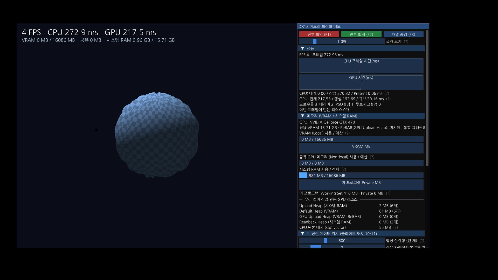

# DX12 공부 저장소 (dx12-study)

DX12 를 공부하면서 만든 코드를 모아 두는 곳이에요. 폴더가 두 개 있어요.

| 폴더 | 무엇 | 언제 고치나 |
|---|---|---|
| [`memdemo/`](memdemo/) | 발표 "DX12 메모리 구조 이해하기" 시연용 **메모리 최적화 데모** (시나리오 10개, VRAM/RAM 패널) | 발표용이라 안정성이 우선. 꼭 필요할 때만 |
| [`lab/`](lab/) | **학습 실습 앱**. 공부한 주제마다 장면을 하나씩 추가 (장면 1: 래스터라이저) | 공부할 때마다 마음껏 |

둘 다 Windows 에서 각 폴더의 `build.bat` 을 더블클릭하면 빌드하고 바로 실행돼요 (Visual Studio 2026 / 2022).



## 깃(Git) 아주 짧은 사용법

비유: 깃은 **게임 세이브 슬롯**이에요. 잘 될 때 세이브(커밋)해 두면, 나중에 망가져도 그 시점으로 돌아갈 수 있어요.
GitHub 는 그 세이브 파일을 올려 두는 **클라우드 보관함**이에요(푸시 = 올리기, 풀 = 내려받기).

처음 한 번 (명령 프롬프트 또는 PowerShell):

```
cd %USERPROFILE%\source\repos
git clone https://github.com/wjrm600/dx12-study.git
```

공부하다가 잘 되는 상태가 되면:

```
cd %USERPROFILE%\source\repos\dx12-study
git add -A
git commit -m "장면 2: 큐브와 깊이 버퍼 추가"
git push
```

다른 곳(예: Claude)이 올린 변경을 받을 때:

```
git pull
```

Visual Studio 2026 을 쓰면 메뉴 **Git → 리포지토리 복제** 로 clone 하고, **Git 변경 내용** 창에서 메시지 쓰고 "모두 커밋" → "푸시" 버튼으로도 같은 일을 할 수 있어요.

`build/` 폴더(빌드 결과물)는 `.gitignore` 에 있어서 올라가지 않아요. 코드만 올라가요.
