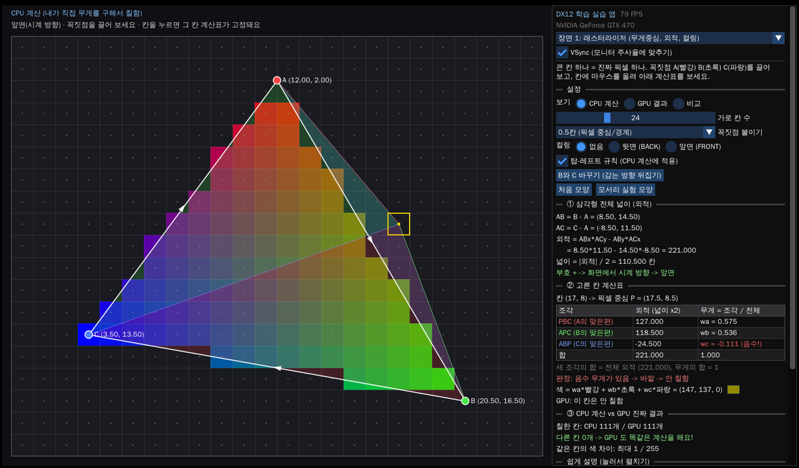
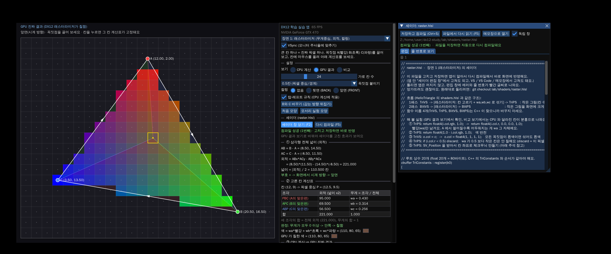
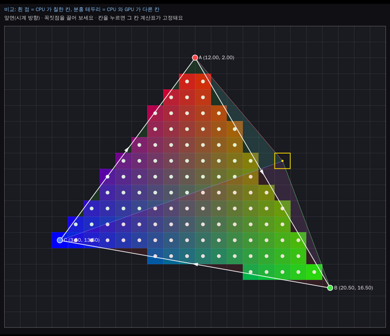

# DX12 학습 실습 앱 (lab)

공부한 주제마다 **장면(Scene)** 을 하나씩 만들어 이 앱 안에 차곡차곡 쌓는 앱이에요.
오른쪽 패널 맨 위의 장면 메뉴에서 고릅니다.

발표용 메모리 데모(`../memdemo`)와는 따로 있어요. 발표 데모는 무대에서 안정적으로 돌아가야 해서 건드리지 않고,
여기서는 마음껏 실험하고 고쳐도 됩니다.



## 빌드하고 실행

1. `build.bat` 을 더블클릭하세요. Visual Studio 2026 / 2022 를 자동으로 찾아서 빌드하고 바로 실행해요.
2. Visual Studio 에서 보고 싶으면 빌드 뒤에 생기는 `build\DX12StudyLab.sln` 을 여세요. (시작 프로젝트가 이미 DX12StudyLab 으로 잡혀 있어요.)

필요한 것: Windows 10/11, DX12 를 지원하는 GPU, Visual Studio 의 "C++를 사용한 데스크톱 개발" 워크로드.
외부 다운로드는 없어요 (ImGui 는 `third_party/imgui` 에 들어 있어요. 창을 밖으로 꺼낼 수 있는 docking 판이에요).

## 셰이더 보고 고치기 (핫 리로드)

장면마다 셰이더가 `shaders/` 폴더에 따로 있어요 (HelloTriangle 의 `shaders.hlsl` 처럼). 장면 1은 [`shaders/raster.hlsl`](shaders/raster.hlsl).

- 앱 안 **셰이더 창**(F2)에서 코드를 보고 고친 뒤 **Ctrl+S** 를 누르면 바로 다시 컴파일돼서 화면에 반영돼요.
- 셰이더 창은 **메인 창과 따로 노는 독립 창**이에요 (작업 표시줄에도 따로 나와요). 모니터에 자리가 있으면 메인 창 오른쪽에 나란히 뜨고, 다른 모니터로 끌어 옮겨도 돼요. 셰이더 창의 "독립 창" 체크를 끄면 메인 창 안에 붙어요.
- VS / VS Code / 메모장에서 파일을 고쳐 저장해도 0.3초 안에 알아서 반영돼요 (앱을 다시 빌드하거나 껐다 켤 필요 없음).
- 틀리면 앱은 꺼지지 않아요. 셰이더 창에 에러와 줄 번호가 빨간 글씨로 나오고, 화면은 마지막으로 성공한 셰이더로 계속 그려요. "줄 번호로 보기" 탭에서 에러 난 줄이 빨간색이에요.
- 망가뜨려도 괜찮아요: `git checkout lab/shaders/raster.hlsl` 로 원래대로 돌아가요.
- 파일 맨 위 주석에 해 볼 실험 ①~⑤가 있어요 (빨강만 남기기, 색 반전, discard, 체크무늬 ...).



## 장면 목록

| 번호 | 장면 | 배운 곳 |
|---|---|---|
| 1 | 래스터라이저: 무게중심(wa, wb, wc), 외적 넓이, 컬링, 탑-레프트 규칙 | HelloTriangle 실습 가이드의 셰이더 놀이터 ④⑤, 래스터라이저 절 |
| (예정) | 큐브와 깊이 버퍼 | HelloTriangle 실습 5 |
| (예정) | 텍스처 SRV + 샘플러 | HelloTriangle 실습 4 |
| (예정) | 루트 시그니처 / 루트 상수 / CBV | HelloTriangle 실습 3 |

## 장면 1: 래스터라이저

큰 칸 하나 = 진짜 픽셀 하나라고 생각하세요 (돋보기로 크게 본 화면).
꼭짓점 A(빨강), B(초록), C(파랑)를 마우스로 끌어 보세요.

- **CPU 계산 보기**: 앱이 칸마다 직접 외적을 계산해서 칠한 그림이에요. 칸 색이 그대로 (wa, wb, wc) 예요.
- **GPU 결과 보기**: 같은 삼각형을 진짜 DX12 파이프라인(VS → 래스터라이저 → PS)으로 작은 그림에 그린 뒤 크게 늘린 거예요.
- **비교 보기**: 흰 점 = CPU 가 칠한 칸, 분홍 테두리 = CPU 와 GPU 가 다른 칸. 보통은 0개예요. 즉 **GPU 도 똑같은 계산을 해요.**



칸에 마우스를 올리면 오른쪽에 계산표가 나와요. 칸을 클릭하면 그 칸이 고정돼서 마우스를 패널로 옮겨도 계산표가 그대로 있어요.

### 해 볼 실험

1. **무게 느끼기**: 고른 칸을 A 쪽으로 옮겨 보세요. 빨간 조각(PBC)이 커지면서 wa 가 1 에 가까워져요.
2. **바깥 판정**: 칸을 삼각형 밖으로 옮기면 무게 하나가 음수가 돼요. 음수 = 바깥.
3. **픽셀 중심**: 꼭짓점을 천천히 끌면서 칸이 "딱" 칠해지는 순간을 보세요. 칸 한가운데 점을 넘을 때예요.
4. **컬링**: 컬링을 "뒷면"으로 두고 "B와 C 바꾸기"를 누르세요. 감는 방향이 반시계가 되어 삼각형이 통째로 사라져요.
5. **탑-레프트 규칙**: "모서리 실험 모양"을 누르고 비교 보기에서 규칙을 끄세요. 오른쪽 아래 빗변 위 칸들이 분홍으로 바뀌어요(GPU 는 항상 규칙을 씀).

### 코드 찾기 (Ctrl+F)

| 표시 | 내용 |
|---|---|
| `[래스터-①]` | CPU 래스터라이저 `Evaluate()`: 외적 → 무게 → 안/밖 |
| `[래스터-②]` | 탑-레프트 규칙 `IsTopLeftEdge()` |
| `[래스터-③]` | 컬링: 외적 부호, PSO 의 `CullMode` |
| `[래스터-④]` | GPU 1패스 `RenderTriangleToLowRes()`: 루트 상수 + `SV_VertexID`, 정점 버퍼 없이 삼각형 그리기 |
| `[래스터-⑤]` | GPU 2패스 `DrawLowResToScreen()`: 작은 그림을 POINT 샘플러로 크게 늘리기 |
| `[래스터-⑥]` | 되읽기 `CopyLowResToReadback()` → 2프레임 뒤 `OnFrameReused()` 에서 CPU 가 읽고 칸마다 비교 |

### 함수 흐름 (DirectX-Graphics-Samples 처럼 단계별 작은 함수)

큰 함수는 "목차"처럼 단계 이름만 부르고, 실제 일은 작은 함수가 해요. 목차 함수부터 읽으면 흐름이 보여요.

| 목차 함수 | 부르는 단계 |
|---|---|
| `InitD3D()` (core.cpp, Samples 의 `LoadPipeline`) | `CreateFactory` → `CreateDevice` → `CheckTearingSupport` → `CreateCommandQueue` → `CreateSwapChain` → `CreateDescriptorHeaps` → `CreateBackBufferViews` → `CreateFrameResources` |
| `EndFrame()` (core.cpp) | `RecordImGui` → 백 버퍼 PRESENT 로 → `SubmitAndPresent` |
| `WinMain()` (main.cpp) | `CreateMainWindow` → `InitD3D` → `InitImGui`(`LoadFonts`) → `RunMainLoop`(`PumpMessages`, `RenderOneFrame`, `AutoTestStep`) → `Shutdown` |
| `RasterScene::Init()` (Samples 의 `LoadAssets`) | `CreateRootSig` → `BuildPipelines`(`CompileShaders`, `CreatePsos`) → `CreateReadbackBuffers` → `CreateLowRes` |
| `RasterScene::OnRender()` (Samples 의 `PopulateCommandList`) | `SetRootArguments` → `RenderTriangleToLowRes` → `CopyLowResToReadback` → `DrawLowResToScreen` |
| `RasterScene::OnCanvas()` | `LayoutGrid` → `HandleMouse` → `DrawCells` → `DrawGridLines` → `DrawSelectedCell` → `DrawTriangleEdges` → `DrawVertices` → `DrawStatusText` |
| `RasterScene::OnPanel()` | `PanelSettings` → `PanelShader` → `PanelWholeTriangle` → `PanelCellTable` → `PanelCellVerdict` → `PanelCellColors` → `PanelCompare` → `PanelEli5` → `PanelCodeFlow` |
| `DrawShaderEditor()` (shader_file.cpp) | `EditorToolbar` → `EditorStatus` → `EditorEditTab` / `EditorLinesTab` |

### 쉬운 용어 풀이

- **래스터라이저**: 모눈종이 위 삼각형을 보고 "이 칸 가운데 점이 안에 있나?"를 물어 칠할 칸을 정하는 GPU 의 고정 단계. VS 다음, PS 앞.
- **외적(2D)**: 두 화살표 AB, AC 로 만든 평행사변형 넓이. `ABx*ACy - ABy*ACx`. 삼각형 넓이는 그 절반, 부호는 감는 방향(화면 좌표에서 + = 시계 방향).
- **무게중심 좌표 wa, wb, wc**: 점 P 를 세 꼭짓점이 나눠 가진 몫. `wa = 넓이(PBC) / 넓이(ABC)`. 합은 항상 1. 셋 다 0 이상이면 안쪽.
- **컬링**: 뒷면 삼각형을 칸 계산 전에 통째로 버리기. DX12 기본은 화면에서 시계 방향 = 앞면(`FrontCounterClockwise = FALSE`).
- **탑-레프트 규칙**: 픽셀 중심이 모서리에 딱 걸치면, 그 모서리가 위쪽 수평 모서리나 왼쪽 모서리일 때만 칠하기. 두 삼각형이 같은 픽셀을 두 번 칠하거나 틈이 생기는 걸 막음.
- **1/256 반올림**: GPU 는 꼭짓점 좌표를 픽셀의 1/256 단위로 맞춘 뒤 계산해요. 이 앱도 똑같이 맞춰서 CPU 와 GPU 결과가 칸 하나까지 같아요.

## 파일 구성

```
lab/
  build.bat            더블클릭 빌드 + 실행
  CMakeLists.txt       scenes/*.cpp 를 자동으로 빌드에 넣음
  src/
    main.cpp           창, ImGui, 장면 메뉴, 메인 루프
    core.h / core.cpp  모든 장면이 같이 쓰는 DX12 뼈대 (장치, 스왑체인, 펜스, 프레임 자원)
    shader_file.*      .hlsl 읽기, 저장하면 다시 컴파일, 셰이더 창
    scene.h            장면이 채울 함수 목록
    scenes/
      scene_raster.cpp 장면 1
  shaders/
    raster.hlsl        장면 1 셰이더 (실행 중에 읽음, 고치면 바로 반영)
  third_party/imgui    Dear ImGui 1.92.6 (docking 판: 멀티 뷰포트 = ImGui 창을 OS 창으로 꺼내기)
```

비유하면 `core` 는 주방(가스레인지, 냄비)이고, 장면은 오늘의 레시피예요. 레시피마다 주방을 새로 짓지 않아요.

## 새 장면 추가하는 법

1. `src/scenes/scene_raster.cpp` 를 복사해서 `src/scenes/scene_cube.cpp` 처럼 이름을 바꿔요.
2. 클래스 이름, `Name()`, 맨 아래 `CreateXxxScene()` 함수 이름을 바꾸고 내용을 새 주제로 채워요.
3. `src/scene.h` 아래에 `Scene* CreateCubeScene();` 한 줄 추가.
4. `src/main.cpp` 의 `kScenes` 목록에 `CreateCubeScene,` 한 줄 추가.
5. `build.bat` 다시 실행. (CMake 가 scenes 폴더의 새 파일을 알아서 찾아요.)

장면이 채우는 함수는 6개뿐이에요: `Init` / `Shutdown` (GPU 자원 만들기·지우기), `OnPanel` (오른쪽 설명 UI),
`OnCanvas` (왼쪽 마우스 처리와 선 그리기), `OnRender` (DX12 명령 기록), `OnFrameReused` (되읽기 결과 꺼내기, 필요할 때만).

## 개발용 자동 테스트

환경 변수 `LAB_AUTOTEST=1` 로 실행하면 장면 1이 74가지 모양(칸 수 4가지, 컬링 3가지, 시계/반시계, 자유 좌표/0.5칸 좌표,
모서리 실험 모양)을 차례로 그리고, CPU 계산과 GPU 결과가 칸마다 같은지 확인한 뒤 `lab_autotest.log` 에 결과를 남기고 끝나요.
마지막 케이스는 탑-레프트 규칙을 끈 CPU 계산이 GPU 와 **달라야** 통과해요.
