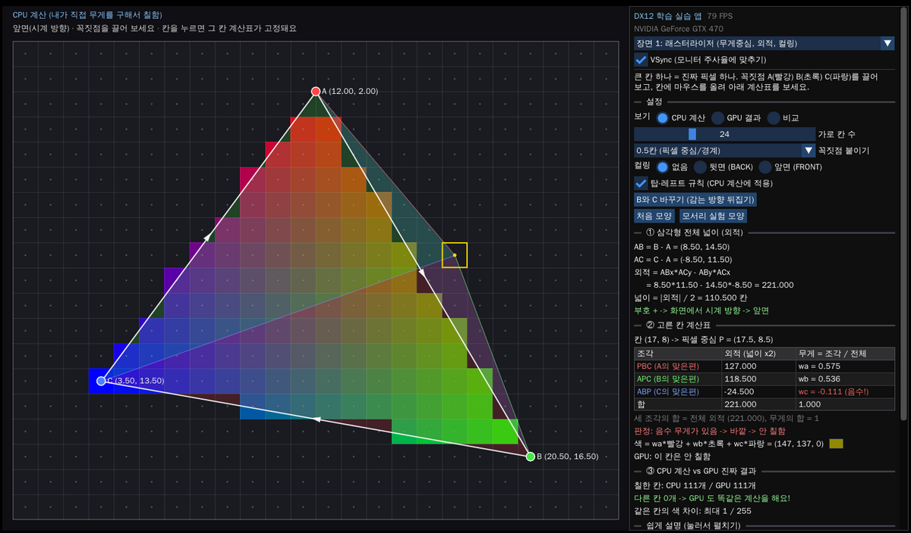
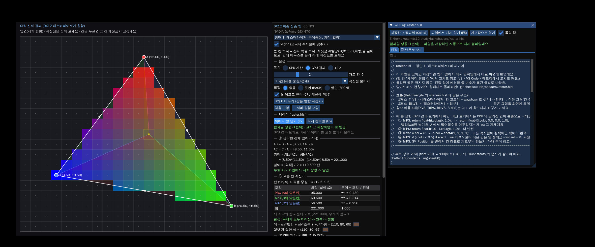
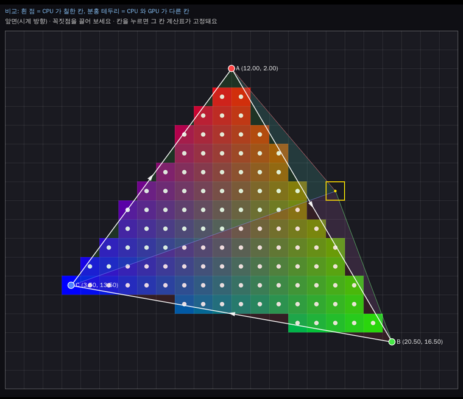
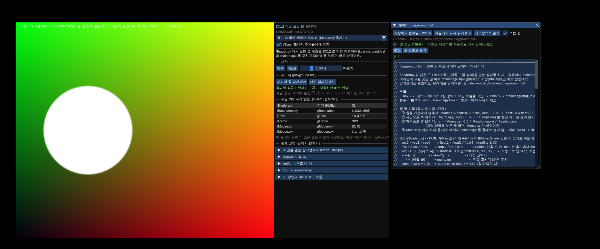
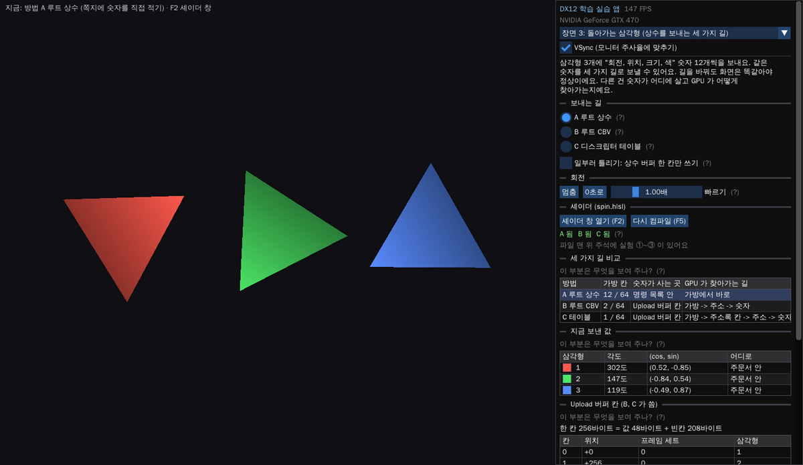
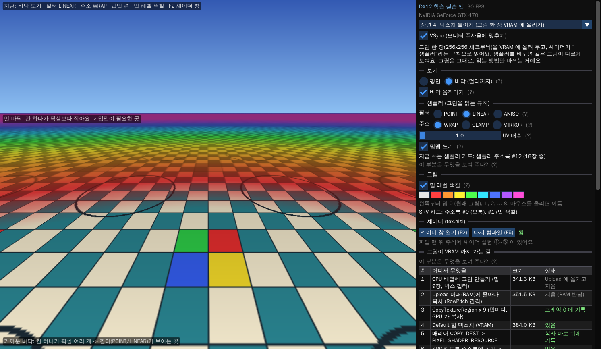
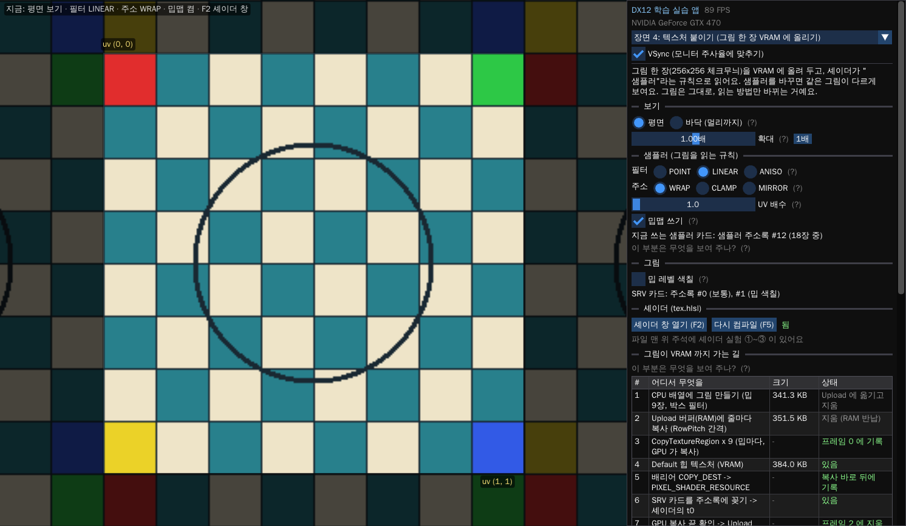

# DX12 학습 실습 앱 (lab)

공부한 주제마다 **장면(Scene)** 을 하나씩 만들어 이 앱 안에 차곡차곡 쌓는 앱이에요.
오른쪽 패널 맨 위의 장면 메뉴에서 고릅니다.

발표용 메모리 데모(`../memdemo`)와는 따로 있어요. 발표 데모는 무대에서 안정적으로 돌아가야 해서 건드리지 않고,
여기서는 마음껏 실험하고 고쳐도 됩니다.



## 빌드하고 실행

1. `build.bat` 을 더블클릭하세요. Visual Studio 2026 / 2022 를 자동으로 찾아서 빌드하고 바로 실행해요.
2. Visual Studio 에서 보고 싶으면 빌드 뒤에 생기는 `build\DX12StudyLab.sln` 을 여세요. (시작 프로젝트가 이미 DX12StudyLab 으로 잡혀 있어요.)

필요한 것: Windows 10/11, DX12 를 지원하는 GPU, Visual Studio 의 "C++를 사용한 데스크톱 개발" 워크로드.
외부 다운로드는 없어요 (ImGui 는 `third_party/imgui` 에 들어 있어요. 창을 밖으로 꺼낼 수 있는 docking 판이에요).

## 셰이더 보고 고치기 (핫 리로드)

장면마다 셰이더가 `shaders/` 폴더에 따로 있어요 (HelloTriangle 의 `shaders.hlsl` 처럼). 장면 1은 [`shaders/raster.hlsl`](shaders/raster.hlsl).

- 앱 안 **셰이더 창**(F2)에서 코드를 보고 고친 뒤 **Ctrl+S** 를 누르면 바로 다시 컴파일돼서 화면에 반영돼요.
- 셰이더 창은 **메인 창과 따로 노는 독립 창**이에요 (작업 표시줄에도 따로 나와요). 모니터에 자리가 있으면 메인 창 오른쪽에 나란히 뜨고, 다른 모니터로 끌어 옮겨도 돼요. 셰이더 창의 "독립 창" 체크를 끄면 메인 창 안에 붙고, 그 상태에서 다시 밖으로 끌어내면 체크가 저절로 켜져요. 독립 창일 때는 보통 윈도우 창처럼 제목 표시줄에 최소화·최대화·닫기 버튼이 있고, 제목 표시줄을 더블 클릭해도 최대화/원래 크기로 바뀌어요.
- VS / VS Code / 메모장에서 파일을 고쳐 저장해도 0.3초 안에 알아서 반영돼요 (앱을 다시 빌드하거나 껐다 켤 필요 없음).
- 틀리면 앱은 꺼지지 않아요. 셰이더 창에 에러와 줄 번호가 빨간 글씨로 나오고, 화면은 마지막으로 성공한 셰이더로 계속 그려요. "줄 번호로 보기" 탭에서 에러 난 줄이 빨간색이에요.
- 망가뜨려도 괜찮아요: 셰이더 창의 **"처음 코드로"** 버튼을 누르면 저장소에 처음 들어 있던 코드로 돌아가요.
  지금 코드는 `shaders/backup/` 에 한 벌 남겨 두니, 실수로 눌렀으면 "되돌리기 취소"를 누르면 돼요.
  (처음 코드는 `shaders/original/` 에 있어요. `git checkout lab/shaders/raster.hlsl` 로 돌려도 같아요.)
- 파일 맨 위 주석에 해 볼 실험 ①~⑤가 있어요 (빨강만 남기기, 색 반전, discard, 체크무늬 ...).



## 장면 목록

| 번호 | 장면 | 배운 곳 |
|---|---|---|
| 1 | 래스터라이저: 무게중심(wa, wb, wc), 외적 넓이, 컬링, 탑-레프트 규칙 | HelloTriangle 실습 가이드의 셰이더 놀이터 ④⑤, 래스터라이저 절 |
| 2 | 픽셀 셰이더 놀이터: Shadertoy 구조(화면 덮는 삼각형 + PS)를 DX12 로, iTime·iResolution·iMouse = 루트 상수 | 학습 로드맵 1단계 |
| 3 | 돌아가는 삼각형: 같은 상수를 루트 상수 / 루트 CBV / 디스크립터 테이블 세 가지 길로, Upload 버퍼 256바이트 칸, "한 칸만 쓰기" 일부러 틀리기 | 로드맵 2단계, HelloTriangle 실습 3 |
| 4 | 텍스처 붙이기: 그림을 Upload -> VRAM 으로 올리기(CopyTextureRegion, 배리어), SRV 카드, 샘플러(필터, 주소 모드, 밉맵), 밉 직접 만들기 | 로드맵 3단계, HelloTriangle 실습 4 |
| 5 | 정점 버퍼: 점을 Default 힙(VRAM)의 정점·인덱스 버퍼로 넘기는 게임 방식, 최소 방식(Upload 힙, HelloTriangle) · 버퍼 없음(SV_VertexID)과 비교 | 셰이더 발표 8~14쪽 (입력 조립기) |
| (예정) | 큐브와 깊이 버퍼 | 로드맵 4단계, HelloTriangle 실습 5 |

## 게임 방식과 비교용 최소 방식

이 앱의 코드는 **실제 게임에서 그대로 쓸 수 있는 방식**을 기본으로 해요. 코드를 줄인 방식은 배우기 좋아서 남겨 두되, 이름과 주석에 **(비교용)** 이라고 표시해요.

| 하는 일 | 게임 방식 (기본) | 비교용 최소 방식 | 어디서 |
|---|---|---|---|
| 모델 점(정점) 넘기기 | 정점·인덱스 버퍼를 Default 힙(VRAM)에. Upload 짐 칸 → `CopyBufferRegion` → 배리어 → 펜스 대기 → 짐 칸 지우기 (`CreateDefaultBuffer`, `CreateMesh`) | Upload 힙에 하나만 (`CreateUploadBufferWithData`, HelloTriangle 과 같음) / 셰이더에 직접 적고 `SV_VertexID` | `src/mesh.cpp` `[정점-②~⑨]`, 장면 5 |
| 장면 3 삼각형 모양 | 정점 버퍼 (Default 힙) 하나를 삼각형 3개가 같이 씀 | 체크 상자 "비교용: 정점 버퍼 없이" | `[회전-⑦]` |
| 장면 4 평면 그림 | 네모 = 정점 4개(위치 + uv) + 인덱스 6개 (Default 힙) | (없음) | `[텍스처-⑧]` |
| 화면 전체를 칠하기 (장면 2 놀이터, 장면 4 바닥) | 화면을 덮는 삼각형 하나 + `SV_VertexID`. **게임의 후처리·하늘도 이렇게 그려요** (모양이 늘 같아서 버퍼가 필요 없음) | | `[놀이터-④]` |
| 텍스처 올리기 (장면 4) | Default 힙 + Upload 버퍼 + `CopyTextureRegion` + 배리어, 프레임이 돌아온 뒤 Upload 지우기 | | `[텍스처-②~④]` |
| 장면 1 래스터라이저 | 배우기용 시각화 (꼭짓점을 마우스로 매 프레임 옮겨서 루트 상수로 보냄) | | `[래스터-④]` |

정점 버퍼가 처음이면 장면 5부터 보세요. 같은 도형을 A 게임 방식 / B 최소 방식 / C 버퍼 없음으로 바꿔 가며, 버퍼가 어디(VRAM, RAM)에 있고 올릴 때 무슨 일을 했는지 패널 표로 보여 줘요.

순서와 단계별 실험 체크리스트는 [DX12 학습 로드맵](https://claude.ai/artifact/19cW9MwFY7VyhbSDZ6Q8eS) 에 있어요.

## 장면 1: 래스터라이저

큰 칸 하나 = 진짜 픽셀 하나라고 생각하세요 (돋보기로 크게 본 화면).
오른쪽 패널의 설정마다 붙은 **(?)** 에 마우스를 올리면 그 설정이 무엇을 보여 주는지 나오고, 누르면 패널 안에 펼쳐져요.
꼭짓점 A(빨강), B(초록), C(파랑)를 마우스로 끌어 보세요.

- **CPU 계산 보기**: 앱이 칸마다 직접 외적을 계산해서 칠한 그림이에요. 칸 색이 그대로 (wa, wb, wc) 예요.
- **GPU 결과 보기**: 같은 삼각형을 진짜 DX12 파이프라인(VS → 래스터라이저 → PS)으로 작은 그림에 그린 뒤 크게 늘린 거예요.
- **비교 보기**: 흰 점 = CPU 가 칠한 칸, 분홍 테두리 = CPU 와 GPU 가 다른 칸. 보통은 0개예요. 즉 **GPU 도 똑같은 계산을 해요.**



칸에 마우스를 올리면 오른쪽에 계산표가 나와요. 칸을 클릭하면 그 칸이 고정돼서 마우스를 패널로 옮겨도 계산표가 그대로 있어요.

### 해 볼 실험

1. **무게 느끼기**: 고른 칸을 A 쪽으로 옮겨 보세요. 빨간 조각(PBC)이 커지면서 wa 가 1 에 가까워져요.
2. **바깥 판정**: 칸을 삼각형 밖으로 옮기면 무게 하나가 음수가 돼요. 음수 = 바깥.
3. **픽셀 중심**: 꼭짓점을 천천히 끌면서 칸이 "딱" 칠해지는 순간을 보세요. 칸 한가운데 점을 넘을 때예요.
4. **컬링**: 컬링을 "뒷면"으로 두고 "B와 C 바꾸기"를 누르세요. 감는 방향이 반시계가 되어 삼각형이 통째로 사라져요.
5. **탑-레프트 규칙**: "모서리 실험 모양"을 누르고 비교 보기에서 규칙을 끄세요. 오른쪽 아래 빗변 위 칸들이 분홍으로 바뀌어요(GPU 는 항상 규칙을 씀).

### 코드 찾기 (Ctrl+F)

| 표시 | 내용 |
|---|---|
| `[래스터-①]` | CPU 래스터라이저 `Evaluate()`: 외적 → 무게 → 안/밖 |
| `[래스터-②]` | 탑-레프트 규칙 `IsTopLeftEdge()` |
| `[래스터-③]` | 컬링: 외적 부호, PSO 의 `CullMode` |
| `[래스터-④]` | GPU 1패스 `RenderTriangleToLowRes()`: 루트 상수 + `SV_VertexID`, 정점 버퍼 없이 삼각형 그리기 |
| `[래스터-⑤]` | GPU 2패스 `DrawLowResToScreen()`: 작은 그림을 POINT 샘플러로 크게 늘리기 |
| `[래스터-⑥]` | 되읽기 `CopyLowResToReadback()` → 2프레임 뒤 `OnFrameReused()` 에서 CPU 가 읽고 칸마다 비교 |

### 함수 흐름 (DirectX-Graphics-Samples 처럼 단계별 작은 함수)

큰 함수는 "목차"처럼 단계 이름만 부르고, 실제 일은 작은 함수가 해요. 목차 함수부터 읽으면 흐름이 보여요.

| 목차 함수 | 부르는 단계 |
|---|---|
| `InitD3D()` (core.cpp, Samples 의 `LoadPipeline`) | `CreateFactory` → `CreateDevice` → `CheckTearingSupport` → `CreateCommandQueue` → `CreateSwapChain` → `CreateDescriptorHeaps` → `CreateBackBufferViews` → `CreateFrameResources` |
| `EndFrame()` (core.cpp) | `RecordImGui` → 백 버퍼 PRESENT 로 → `SubmitAndPresent` |
| `WinMain()` (main.cpp) | `CreateMainWindow` → `InitD3D` → `InitImGui`(`LoadFonts`) → `RunMainLoop`(`PumpMessages`, `RenderOneFrame`, `AutoTestStep`) → `Shutdown` |
| `RasterScene::Init()` (Samples 의 `LoadAssets`) | `CreateRootSig` → `BuildPipelines`(`CompileShaders`, `CreatePsos`) → `CreateReadbackBuffers` → `CreateLowRes` |
| `RasterScene::OnRender()` (Samples 의 `PopulateCommandList`) | `SetRootArguments` → `RenderTriangleToLowRes` → `CopyLowResToReadback` → `DrawLowResToScreen` |
| `RasterScene::OnCanvas()` | `LayoutGrid` → `HandleMouse` → `DrawCells` → `DrawGridLines` → `DrawSelectedCell` → `DrawTriangleEdges` → `DrawVertices` → `DrawStatusText` |
| `RasterScene::OnPanel()` | `PanelSettings` → `PanelShader` → `PanelWholeTriangle` → `PanelCellTable` → `PanelCellVerdict` → `PanelCellColors` → `PanelCompare` → `PanelEli5` → `PanelCodeFlow` |
| `DrawShaderEditor()` (shader_file.cpp) | `EditorToolbar` → `EditorStatus` → `EditorEditTab` / `EditorLinesTab` |

### 쉬운 용어 풀이

- **래스터라이저**: 모눈종이 위 삼각형을 보고 "이 칸 가운데 점이 안에 있나?"를 물어 칠할 칸을 정하는 GPU 의 고정 단계. VS 다음, PS 앞.
- **외적(2D)**: 두 화살표 AB, AC 로 만든 평행사변형 넓이. `ABx*ACy - ABy*ACx`. 삼각형 넓이는 그 절반, 부호는 감는 방향(화면 좌표에서 + = 시계 방향).
- **무게중심 좌표 wa, wb, wc**: 점 P 를 세 꼭짓점이 나눠 가진 몫. `wa = 넓이(PBC) / 넓이(ABC)`. 합은 항상 1. 셋 다 0 이상이면 안쪽.
- **컬링**: 뒷면 삼각형을 칸 계산 전에 통째로 버리기. DX12 기본은 화면에서 시계 방향 = 앞면(`FrontCounterClockwise = FALSE`).
- **탑-레프트 규칙**: 픽셀 중심이 모서리에 딱 걸치면, 그 모서리가 위쪽 수평 모서리나 왼쪽 모서리일 때만 칠하기. 두 삼각형이 같은 픽셀을 두 번 칠하거나 틈이 생기는 걸 막음.
- **1/256 반올림**: GPU 는 꼭짓점 좌표를 픽셀의 1/256 단위로 맞춘 뒤 계산해요. 이 앱도 똑같이 맞춰서 CPU 와 GPU 결과가 칸 하나까지 같아요.

## 장면 2: 픽셀 셰이더 놀이터

Shadertoy 의 정체는 "화면을 덮는 삼각형 하나 + 픽셀 셰이더 하나"예요. 이 장면은 그걸 DX12 로 그대로 만든 거예요.
고칠 곳은 [`shaders/playground.hlsl`](shaders/playground.hlsl) 의 `mainImage` 하나뿐이에요 (F2 셰이더 창, Ctrl+S 로 바로 반영).

- 파일 맨 위 주석에 실험 ①~④ 와 **GLSL → HLSL 바꾸는 표**가 있어요. `vec2`, `mix`, `fract`, `iTime` 같은 Shadertoy 이름은 `#define` 으로 그대로 쓸 수 있어요.
- 오른쪽 패널의 표에서 지금 셰이더에 들어가는 iTime, iResolution, iMouse 실제 값을 볼 수 있어요. 그림 영역을 누른 채 끌면 iMouse 가 바뀌어요.
- 시간 멈춤 / 0초로 / 빠르기 버튼이 있어요.



| 표시 (Ctrl+F) | 내용 |
|---|---|
| `[놀이터-①]` | 루트 시그니처: 루트 상수 8개(b0) 하나뿐 |
| `[놀이터-②]` | PSO: 정점 버퍼 없음, 컬링 없음 |
| `[놀이터-③]` | 매 프레임 시간, 그림 크기, 마우스 채우기 |
| `[놀이터-④]` | 뷰포트 = 그림 영역, `DrawInstanced(3)` 한 번 |

## 장면 3: 돌아가는 삼각형 (상수를 보내는 세 가지 길)

삼각형 3개에 "회전, 위치, 크기, 색" 숫자 12개(48바이트)씩을 보내요. 같은 숫자를 세 가지 길로 보낼 수 있고, 오른쪽 패널에서 바꿔 가며 비교해요.
길을 바꿔도 화면은 똑같아야 정상이에요. 다른 건 **숫자가 어디에 살고 GPU 가 어떻게 찾아가는지**예요.

| 방법 | 비유 | 가방(루트 시그니처) 칸 | 숫자가 사는 곳 | 값 넘기는 함수 |
|---|---|---|---|---|
| A 루트 상수 | 쪽지에 숫자를 직접 적기 | 12 / 64 | 명령 목록 안 | `SetGraphicsRoot32BitConstants` |
| B 루트 CBV | 사물함 주소를 적기 | 2 / 64 | Upload 버퍼 칸 | `SetGraphicsRootConstantBufferView` |
| C 디스크립터 테이블 | 주소록 칸 번호를 적기 | 1 / 64 | Upload 버퍼 칸 (주소는 디스크립터 힙에) | `SetGraphicsRootDescriptorTable` |

- 셰이더 [`shaders/spin.hlsl`](shaders/spin.hlsl) 하나를 세 방법이 같이 써요. 셰이더는 "b0 에 값이 있다"만 알아요. 길은 루트 시그니처가 정해요.
- **일부러 틀리기: 상수 버퍼 한 칸만 쓰기** 를 켜면 B, C 에서 삼각형이 1개만 보여요. CPU 가 명령 목록을 쓰는 동안 같은 칸을 세 번 덮어쓰고, GPU 는 나중에 마지막 값만 읽거든요. A 는 숫자가 명령 목록에 복사돼서 괜찮아요.
- 패널에 Upload 버퍼 칸 표가 있어요: 256바이트 칸 6개 = 프레임 자원 세트 2개 x 삼각형 3개. 값은 48바이트인데 칸이 256바이트인 이유(CBV 정렬 규칙)도 (?) 에 있어요.
- 셰이더 파일 맨 위 실험 ③: cbuffer 에 값을 하나 더 넣고 셰이더에서 그 값을 읽으면, 셰이더가 b0 에서 64바이트를 읽어요. 방법 A 의 가방(루트 상수 12개 = 48바이트)을 넘지만 **PSO 는 그래도 만들어져요** (D3D12 는 크기 모자람을 막지 않음). 그래서 패널의 "b0 크기 검사"가 셰이더 리플렉션(`D3DReflect`)으로 직접 비교해서 빨간 경고를 띄워요.



| 표시 (Ctrl+F) | 내용 |
|---|---|
| `[회전-①]` | 보낼 값 12개 (C++ 구조체 = HLSL cbuffer) |
| `[회전-②]` | 루트 시그니처 3개: 가방 모양만 다르고 셰이더는 같다 |
| `[회전-③]` | Upload 버퍼: 256바이트 칸 6개, 한 번 Map 해 두기 |
| `[회전-④]` | 디스크립터: 칸마다 CBV 카드를 주소록(SRV 힙)에 |
| `[회전-⑤]` | 매 프레임 각도 -> cos, sin |
| `[회전-⑥]` | `DrawWithRootConstants` / `DrawWithRootCbv` / `DrawWithTable` 나란히 비교 |
| `[회전-⑦]` | 삼각형 모양 = 정점 버퍼(12바이트 x 3, Default 힙). 비교용 체크 상자를 켜면 `SpinVSNoBuffer`(SV_VertexID) |

## 장면 4: 텍스처 붙이기 (그림 한 장 VRAM 에 올리기)

256x256 체크무늬 그림을 CPU 에서 만들어 VRAM 에 올리고, 셰이더가 샘플러로 읽어요. 샘플러를 바꾸면 **그림은 그대로인데 읽는 방법만** 바뀌어요.
네 모서리 칸 색으로 방향을 알 수 있어요: 왼쪽 위 빨강, 오른쪽 위 초록, 왼쪽 아래 노랑, 오른쪽 아래 파랑.

그림이 VRAM 까지 가는 길 (패널에 진행 상태 표가 있어요):

| # | 어디서 무엇을 | 코드 |
|---|---|---|
| 1 | CPU 배열에 그림 + 밉 8장 (2x2 평균, DX12 에는 `GenerateMips` 가 없음) | `MakeImages` |
| 2 | Default 힙(VRAM) 에 빈 텍스처, 처음 상태 `COPY_DEST` | `CreateCommittedResource` |
| 3 | Upload 버퍼(RAM) 에 줄마다 복사. 줄 간격은 너비가 아니라 `RowPitch` (256바이트 배수) | `GetCopyableFootprints`, `WriteUpload` |
| 4 | 첫 프레임 명령 목록에 밉마다 복사 9번 + 배리어 `COPY_DEST -> PIXEL_SHADER_RESOURCE` | `CopyTextureRegion`, `RecordCopies` |
| 5 | SRV 카드를 주소록(SRV 힙)에 -> 셰이더의 `t0` | `CreateShaderResourceView` |
| 6 | 같은 프레임 세트가 돌아오면(GPU 복사 끝) Upload 버퍼 지우기 | `OnFrameReused` |

- 보기 2가지: **평면**(가운데 네모, 확대 0.05~16배, 마우스 휠) / **바닥**(멀리까지 이어진 바닥, 움직이기).
  평면의 네모는 정점 버퍼(점 4개, 점마다 위치 + uv) + 인덱스 버퍼로 그려요 `[텍스처-⑧]`. 바닥은 화면을 덮는 삼각형 하나에 픽셀 셰이더가 uv 를 계산해요.
- 샘플러: 필터 POINT / LINEAR / ANISOTROPIC, 주소 WRAP / CLAMP / MIRROR, UV 배수 1~4, 밉맵 켬/끔(`MaxLOD = 0`). 카드 18장을 샘플러 힙에 미리 만들어 두고 번호만 바꿔요.
- **밉 레벨 색칠**: 밉 1..8 에 색을 입힌 두 번째 텍스처. 화면 색으로 GPU 가 고른 밉을 볼 수 있어요.
- 루트 시그니처(가방): 칸 0 = SRV 테이블(`t0`), 칸 1 = 샘플러 테이블(`s0`), 칸 2 = 루트 상수 8개(`b0`). 텍스처는 장면 3의 방법 C(디스크립터 테이블)로만 넘길 수 있어요.
- 밉 레벨 표: 밉마다 크기, 바이트, 줄 간격(32x32 이하는 빈칸이 생김), 시작 위치. 밉 9장 = +33%.
- 셰이더 [`shaders/tex.hlsl`](shaders/tex.hlsl) 맨 위 실험: ① uv.y 뒤집기 ② `SampleLevel` 로 밉 직접 고르기 ③ `.bgr` 채널 바꾸기.





| 표시 (Ctrl+F) | 내용 |
|---|---|
| `[텍스처-①]` | CPU 에서 그림 + 밉맵 만들기 |
| `[텍스처-②]` | VRAM 에 빈 텍스처 (Default 힙, COPY_DEST) |
| `[텍스처-③]` | Upload 버퍼에 쓰기 (`GetCopyableFootprints`, RowPitch) |
| `[텍스처-④]` | 복사 명령 + 배리어, 끝나면 Upload 버퍼 지우기 |
| `[텍스처-⑤]` | SRV 카드 |
| `[텍스처-⑥]` | 샘플러 힙 18장 |
| `[텍스처-⑦]` | 루트 시그니처 + 그리기 (`SetDescriptorHeaps` 2권) |
| `[텍스처-⑧]` | 평면 보기 네모 = 정점 버퍼 + 인덱스 버퍼 (Default 힙), `DrawIndexedInstanced(6)` |

## 장면 5: 정점 버퍼 (점을 GPU 에 넘기는 게임 방식)

모델의 점을 GPU 에 넘기는 길을 끝까지 보여 줘요. 같은 도형(삼각형 / 사각형)을 세 가지 방법으로 그려서 비교해요. 그림은 셋 다 같아요.

| 방법 | 점이 있는 곳 | 올릴 때 한 일 | 그리기 |
|---|---|---|---|
| A 게임 방식 | Default 힙 (VRAM) 정점 버퍼 + 인덱스 버퍼 | Upload 짐 칸에 memcpy → `CopyBufferRegion` → 배리어 → 펜스 대기 → 짐 칸 지움 | `IASetVertexBuffers`, `IASetIndexBuffer`, `DrawIndexedInstanced` |
| B 최소 방식 (비교용) | Upload 힙 (RAM) 정점 버퍼 하나. HelloTriangle 과 같음 | Map → memcpy → Unmap 만 | `IASetVertexBuffers`, `DrawInstanced` |
| C 버퍼 없음 (비교용) | 셰이더 안 (`VSNoBufferTri`, `VSNoBufferQuad`) | 없음 | `DrawInstanced` (`SV_VertexID`) |

- 그림 영역의 숫자 = 정점 버퍼 안의 순서. 사각형에서 A 는 점 4개 + 번호표 `0 1 2 | 0 2 3`, B 와 C 는 같은 자리 점을 두 번 적어 점 6개예요.
- 패널 표: 지금 버퍼가 어디(VRAM / RAM)에 있는지, 뷰 세 값(`BufferLocation`, `SizeInBytes`, `StrideInBytes`), 인덱스 버퍼 크기, 그리기 함수, 올릴 때 한 일.
- 정점 한 개 = 28바이트: `POSITION` float3 (0바이트부터 12) + `COLOR` float4 (12바이트부터 16). 입력 레이아웃 7칸 설명은 `scene_vertex.cpp` 의 `kInputLayout` 주석에 있어요.
- 셰이더 [`shaders/vb.hlsl`](shaders/vb.hlsl) 실험: ① 흰색으로 ② 시맨틱 `COLOR` → `COLOUR` 로 일부러 틀리기 (A, B 만 PSO 실패) ③ 위치 반으로.
- 올리는 코드는 다른 장면도 같이 쓰는 도우미 [`src/mesh.h`](src/mesh.h) / [`src/mesh.cpp`](src/mesh.cpp) 에 있어요. 새 장면에서 모델을 그릴 때 `CreateMesh(...)` 한 줄 + `mesh.Draw(cl)` 이면 돼요.

| 표시 (Ctrl+F) | 파일 | 내용 |
|---|---|---|
| `[정점-①]` | `scene_vertex.cpp`, `vb.hlsl` | 정점 구조체 28바이트 + 입력 레이아웃 (시맨틱) |
| `[정점-②]` | `mesh.cpp` | Default 버퍼(VRAM, COMMON) + Upload 짐 칸(GENERIC_READ) |
| `[정점-③]` | `mesh.cpp` | CPU 가 짐 칸에 쓰기: Map, memcpy, Unmap |
| `[정점-④]` | `mesh.cpp` | 배리어 COMMON → COPY_DEST, `CopyBufferRegion`, 배리어 → VERTEX_AND_CONSTANT_BUFFER / INDEX_BUFFER |
| `[정점-⑤]` | `mesh.cpp` | `ExecuteCommandLists` → 펜스로 기다림 → 짐 칸 지움 |
| `[정점-⑥]` | `mesh.cpp` | 정점 버퍼 뷰, 인덱스 버퍼 뷰 |
| `[정점-⑦]` | `scene_vertex.cpp` | 루트 시그니처 `ALLOW_INPUT_ASSEMBLER_INPUT_LAYOUT` + PSO 의 `InputLayout` |
| `[정점-⑧]` | `scene_vertex.cpp`, `mesh.cpp` | `IASetVertexBuffers`, `IASetIndexBuffer`, `DrawIndexedInstanced` |
| `[정점-⑨]` | `mesh.cpp` | 비교용 최소 방식: Upload 힙 하나 (HelloTriangle) |

## 파일 구성

```
lab/
  build.bat            더블클릭 빌드 + 실행
  CMakeLists.txt       scenes/*.cpp 를 자동으로 빌드에 넣음
  src/
    main.cpp           창, ImGui, 장면 메뉴, 메인 루프
    core.h / core.cpp  모든 장면이 같이 쓰는 DX12 뼈대 (장치, 스왑체인, 펜스, 프레임 자원)
    mesh.h / mesh.cpp  정점·인덱스 버퍼를 VRAM 에 올리는 도우미 (게임 방식 + 비교용 최소 방식)
    shader_file.*      .hlsl 읽기, 저장하면 다시 컴파일, 셰이더 창
    scene.h            장면이 채울 함수 목록
    scenes/
      scene_raster.cpp 장면 1
      scene_playground.cpp 장면 2
      scene_spin.cpp   장면 3
      scene_texture.cpp 장면 4
      scene_vertex.cpp 장면 5
  shaders/
    raster.hlsl        장면 1 셰이더 (실행 중에 읽음, 고치면 바로 반영)
    playground.hlsl    장면 2 셰이더 (mainImage 만 고치면 됨)
    spin.hlsl          장면 3 셰이더 (세 방법이 같이 씀)
    tex.hlsl           장면 4 셰이더 (Texture2D t0 + SamplerState s0)
    vb.hlsl            장면 5 셰이더 (VSInput: POSITION, COLOR)
    original/          "처음 코드로" 버튼이 쓰는 처음 코드 (셰이더를 바꿔 커밋할 때 여기도 같이 고치기)
    backup/            "처음 코드로" 를 누르기 직전 코드 (git 에 안 올라감)
  third_party/imgui    Dear ImGui 1.92.6 (docking 판: 멀티 뷰포트 = ImGui 창을 OS 창으로 꺼내기)
```

비유하면 `core` 는 주방(가스레인지, 냄비)이고, 장면은 오늘의 레시피예요. 레시피마다 주방을 새로 짓지 않아요.

## 새 장면 추가하는 법

1. `src/scenes/scene_raster.cpp` 를 복사해서 `src/scenes/scene_cube.cpp` 처럼 이름을 바꿔요.
2. 클래스 이름, `Name()`, 맨 아래 `CreateXxxScene()` 함수 이름을 바꾸고 내용을 새 주제로 채워요.
3. `src/scene.h` 아래에 `Scene* CreateCubeScene();` 한 줄 추가.
4. `src/main.cpp` 의 `kScenes` 목록에 `CreateCubeScene,` 한 줄 추가.
5. `build.bat` 다시 실행. (CMake 가 scenes 폴더의 새 파일을 알아서 찾아요.)

장면이 채우는 함수는 6개뿐이에요: `Init` / `Shutdown` (GPU 자원 만들기·지우기), `OnPanel` (오른쪽 설명 UI),
`OnCanvas` (왼쪽 마우스 처리와 선 그리기), `OnRender` (DX12 명령 기록), `OnFrameReused` (되읽기 결과 꺼내기, 필요할 때만).

## 개발용 자동 테스트

환경 변수 `LAB_AUTOTEST=1` 로 실행하면 장면 1이 74가지 모양(칸 수 4가지, 컬링 3가지, 시계/반시계, 자유 좌표/0.5칸 좌표,
모서리 실험 모양)을 차례로 그리고, CPU 계산과 GPU 결과가 칸마다 같은지 확인한 뒤 `lab_autotest.log` 에 결과를 남기고 끝나요.
마지막 케이스는 탑-레프트 규칙을 끈 CPU 계산이 GPU 와 **달라야** 통과해요.
`LAB_SCENE=2` 를 같이 주면 장면 3을 시험해요: 방법 A, B, C 와 "한 칸만 쓰기" 켬/끔 6가지에서 삼각형 중심 픽셀을 되읽어 기대한 색인지 확인해요.
`LAB_SCENE=3` 이면 장면 4: 평면 모서리 색(빨강, 초록), UV 2배에서 WRAP / MIRROR / CLAMP 가 기대한 칸 색을 읽는지, 바닥 먼 곳 색이 밉 켬/끔에서 다른지, 끝나고 Upload 버퍼가 지워졌는지 확인해요.
`LAB_SCENE=4` 이면 장면 5: 방법 3가지 x 모양 2가지에서 PSO 가 있는지, 버퍼가 맞는 힙(Default / Upload)에 있는지, stride 와 인덱스 수가 맞는지 확인해요.
